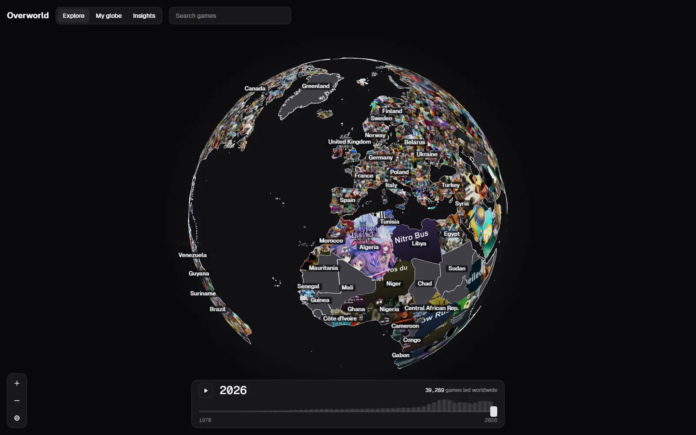

# Overworld

**A 3D globe of where video games are made.**

Thirty thousand games, mapped to the studios that made them.

     

[Features](#features) · [How it works](#how-it-works) · [Data](#where-the-data-comes-from) · [Contributing](#contributing) · [Run it yourself](docs/DEVELOPMENT.md)

 

## Features

- **Explore.** Every country is a mosaic of the games made there, each cover sized by how many people played it. Click a country, a city or a studio for its list, or search any title.
- **Follow a game.** Open one and arcs fly from its lead studio to every company that worked on it: co-development, ports, publishing, localization, QA, art and audio.
- **Travel in time.** Drag the year slider and watch the industry grow from 1970 to today.
- **My globe.** Enter a public Steam profile and see where your library was made, such as "43% of your games come from the United States". A sample library works without one.
- **Insights.** Games per million people by country, genres by region, indie and major publishers over time, and where outside work flows between countries.
- **Share.** Every view has its own link, and any game card can be saved or shared as an image.

<table>
  <tr>
    <td width="50%"></td>
    <td width="50%"></td>
  </tr>
  <tr>
    <td align="center"><b>A game and every studio behind it</b></td>
    <td align="center"><b>A country, its cities and its games</b></td>
  </tr>
  <tr>
    <td></td>
    <td></td>
  </tr>
  <tr>
    <td align="center"><b>Insights by country and region</b></td>
    <td align="center"><b>Where your Steam library was made</b></td>
  </tr>
</table>

## How it works

**One dataset from many sources.** A pipeline pulls games, companies and their roles from IGDB, player numbers from Steam, RAWG and IGDB, studio headquarters from Wikidata and extra credits from MobyGames, then merges them into static files. The set is every main game, remake or remaster with at least 5,000 estimated players: about 39,000 games, 22,000 companies and 162 countries.

**Every point can be traced.** Each game records how its lead studio was chosen, and each studio how its location was found: a hand correction, a Wikidata headquarters, its parent company's city, or only a country. The game card shows this, so a weak guess looks like one.

**A mosaic, not a map pin.** Each country is cut into cells with a weighted Voronoi treemap, and every cell's area follows a game's popularity. Turn on zoom detail and the cells keep splitting as you zoom in, until every game has its own.

  

**Known limits.** A studio sits where it is based now, not where it was when each game was made. IGDB rarely records localization, QA, art or audio work, so those arcs are sparse. About 8,800 games are not drawn because no source knows where their lead studio is.

The full tour of the code is in [docs/ARCHITECTURE.md](docs/ARCHITECTURE.md).

## Where the data comes from

| Source | Used for |
| --- | --- |
| [IGDB](https://www.igdb.com) | games, companies, roles, covers |
| [Wikidata](https://www.wikidata.org) | studio headquarters, coordinates, populations |
| [SteamSpy](https://steamspy.com) and Steam | player estimates and the libraries in My globe |
| [RAWG](https://rawg.io) | console and older games; each game card links its RAWG page |
| [MobyGames](https://www.mobygames.com) | extra developer and publisher credits |
| [Natural Earth](https://www.naturalearthdata.com), [GeoNames](https://www.geonames.org) | country shapes and city coordinates |

Overworld is not affiliated with or endorsed by any of these sources, Valve or any game company. Game titles and artwork belong to their owners. Full credits and licenses: [THIRD_PARTY_NOTICES.md](THIRD_PARTY_NOTICES.md).

## Privacy

No accounts, no cookies, no ads. The site counts anonymous usage, such as which games are opened, so it can get better; it never records IP addresses, search text or Steam profiles. Do Not Track is respected, and `?noanalytics=1` turns counting off. Details: [docs/PRIVACY.md](docs/PRIVACY.md).

## Contributing

Found a studio in the wrong city, or a game credited to the wrong studio? That is the most useful fix, and it needs no code: [CONTRIBUTING.md](CONTRIBUTING.md) shows the format, with a source link for every change.

| I want to… | Read |
| --- | --- |
| fix a location or a lead studio | [CONTRIBUTING.md](CONTRIBUTING.md) |
| run the code on my machine | [docs/DEVELOPMENT.md](docs/DEVELOPMENT.md) |
| understand how it is built | [docs/ARCHITECTURE.md](docs/ARCHITECTURE.md) |
| host my own copy | [docs/SELF-HOSTING.md](docs/SELF-HOSTING.md) |
| report a security problem | [SECURITY.md](SECURITY.md) |

## Thanks

Overworld started after I saw [Satellites](https://github.com/dev-Armaan/satellites) by [dev-Armaan](https://github.com/dev-Armaan), a 3D globe of satellites in orbit. I wanted the same feeling for games: one globe, and every dot something you can click and trace back to where it came from.

## License

Code under the [MIT License](LICENSE), © 2026 Artem Kovtoniuk and Overworld contributors. Libraries, fonts, map data and game data keep their own terms.

 
<a href="https://overworld.maybaah.com"><b>overworld.maybaah.com</b></a>

