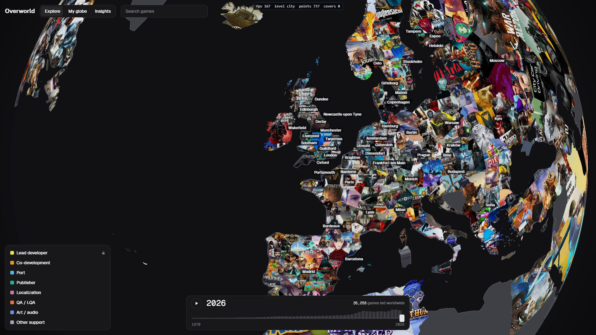
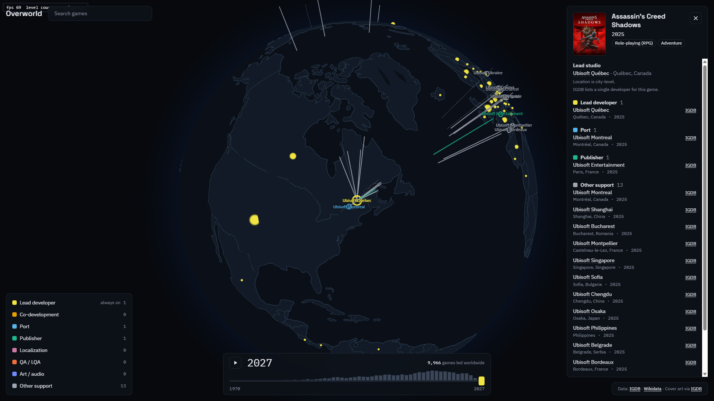

# Overworld

A 3D globe that shows where video games were made.

Every game sits at its lead developer studio. Open a game and arcs go out to every other company that worked on it, colored by role: co-development, port, publisher, localization, QA, outsourced art and audio. A game made by several studios in several countries is the main thing the globe is built to show.

The globe is a satellite map with country and city names. Each place shows the cover of the most popular game made there, and the covers change as you move the year slider.





## What it does

- **Explore** – places grouped by country, city and studio as you zoom, each shown by a game cover; search; a card per game with every company, its role and a link to the source record; a year slider from 1970 to now.
- **My globe** – enter a public Steam profile (or try a sample library) and see where your games come from, e.g. "42% of your games come from the United States".
- **Insights** – games per capita by country, genres by region, indie and major-publisher output over time, and where outside work flows between countries.
- **Sharing** – a share button with a card image; every game has its own link-preview page.

Status: the data pipeline, Explore, My globe, Insights and sharing are built, tested and reviewed in a real browser. A guess-the-location game is built but not released yet (it opens only with `?mode=guess`). Localization, QA and art/audio links are nearly empty until a source that records them is added. See [PROGRESS.md](PROGRESS.md) for the current state and the decisions behind it, and `reports/` for the validation and performance reports.

## How the data is made

```
IGDB  ──►  games, companies, roles (developer / publisher / port / support)
Wikidata ─►  studio headquarters and coordinates, country of origin
hand-kept corrections (each with an evidence link)
        │
        ▼
   merge ──► validate ──► static JSON in web/public/data/
```

- About 10,000 of the most-rated games on IGDB and every company credited on them.
- Each record keeps the name and id of the source it came from, so any point on the globe can be traced back.
- Each game records how its lead studio was chosen, and each company records how its location was found. Weak cases (several developers with nothing to tell them apart, a country but no city) are marked as such in the app and listed in the reports.
- Generated data is not committed. Run the pipeline to produce it, or use the sample data.

Known limits:

- A studio is placed where it is based now (or was last based), not where it was when a particular game was made.
- IGDB has no separate flags for localization, QA, art or audio work, so those roles are sparse.
- About a fifth of the companies have no known location. They are listed in `reports/validation.md` and not drawn.

## Quick start

Requirements: Node 22 or newer.

```bash
npm install
npm install --prefix web
```

### Run with sample data (no API keys)

```bash
npm run fixture
npm run dev --prefix web
```

The sample set has 10,000 obviously fake games in real cities, and the app labels it as sample data.

### Run with real data

1. Copy `.env.example` to `.env` and fill in the keys (see below).
2. Build the data and start the app:

```bash
npm run pipeline
npm run dev:real --prefix web
```

`npm run pipeline` fetches from the sources (cached in `pipeline/.cache/`), merges, writes `web/public/data/` and validates it. Add `-- --refresh` to fetch again, `-- --limit=500` for a smaller set, `-- --only=merge,validate` to rerun single stages.

### API keys

| Key | Needed for | Where to get it |
| --- | --- | --- |
| `TWITCH_CLIENT_ID`, `TWITCH_CLIENT_SECRET` | IGDB (required for real data) | Register an application at <https://dev.twitch.tv/console/apps> |
| `STEAM_API_KEY` | My globe | <https://steamcommunity.com/dev/apikey> |
| `MOBYGAMES_API_KEY` | optional extra credits | <https://www.mobygames.com/info/api/> |
| `WIKIDATA_USER_AGENT_CONTACT` | a contact string for Wikidata requests | a URL or email of your choice |

Keys live only in `.env`, which is git-ignored. The Steam key is used by a small relay on the server side (`web/server/`) and never reaches the browser.

## Commands

| Command | What it does |
| --- | --- |
| `npm run pipeline` | fetch, merge, write data, validate |
| `npm run validate` | check `web/public/data/` and write `reports/validation.md` |
| `npm run fixture` | write sample data to `web/public/data-fixture/` |
| `npm test` | pipeline tests |
| `npm test --prefix web` | app tests |
| `npm run build --prefix web` | production build |
| `node scripts/measure.mjs --data=real` (in `web/`) | frame-rate and behavior check in a real Chrome |
| `node scripts/supabase.mjs migrate` | apply `supabase/migrations/` to your Supabase project |
| `node scripts/supabase.mjs add-admin <email>` | let an address read `/admin.html` |

## Layout

```
shared/model.ts      data contract used by the pipeline and the app
pipeline/src/        fetch stages, merge, validation
pipeline/data/       hand-kept corrections (locations, lead studios, specialties)
web/src/             the app: data layer, globe, panels, guess, My globe, insights
web/src/admin/       the /admin.html usage stats page
web/src/telemetry/   anonymous usage events sent by the app
web/server/          Cloudflare Worker: Steam relay and usage events relay
supabase/            database schema for usage stats, with tests
scripts/             Supabase helper
reports/             validation, review and performance reports
docs/                API research notes and screenshots
```

## Usage stats and the admin page

The public site counts anonymous usage (game opens, searches, shares, load time, errors) and shows it on `/admin.html` to the addresses on its admin list. No cookies, no IP addresses, raw events deleted after 48 hours: [docs/PRIVACY.md](docs/PRIVACY.md). Open any page with `?noanalytics=1` to send nothing.

A fork records nothing until its owner sets up their own Supabase project: [docs/SELF-HOSTING.md](docs/SELF-HOSTING.md). To see the admin page without a backend, open `/admin.html?mock=1`.

## Data sources and attribution

- Game, company and role data: [IGDB](https://www.igdb.com), used under the IGDB API terms. Cover art and screenshots are served by IGDB.
- Headquarters, coordinates and population: [Wikidata](https://www.wikidata.org), CC0.
- City names and coordinates for corrections: [GeoNames](https://www.geonames.org), CC BY 4.0, through the `all-the-cities` package.
- Country shapes: [Natural Earth](https://www.naturalearthdata.com) through `world-atlas`.
- Satellite imagery: Sentinel-2 cloudless – <https://s2maps.eu> by EOX IT Services GmbH (Contains modified Copernicus Sentinel data 2016 & 2017), CC BY 4.0.
- Game library data in My globe: Steam Web API. Overworld is not affiliated with Valve or Steam.

Overworld is not affiliated with or endorsed by IGDB, Twitch, Wikidata, MobyGames, Valve or any game company. Game titles and artwork belong to their owners.

## Contributing

Corrections to studio locations and lead studios are especially welcome, and need no code. See [CONTRIBUTING.md](CONTRIBUTING.md).

## License

Code: [MIT](LICENSE). The data produced by the pipeline comes from the sources above and stays under their terms.
