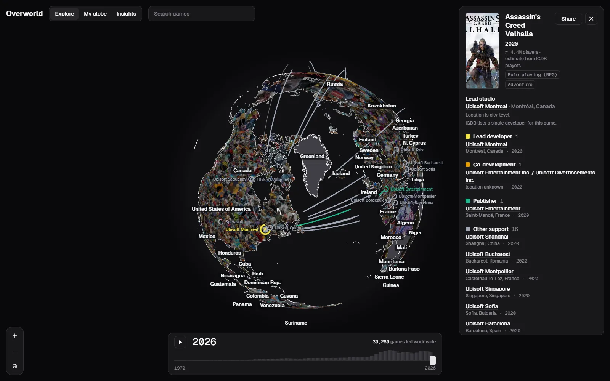
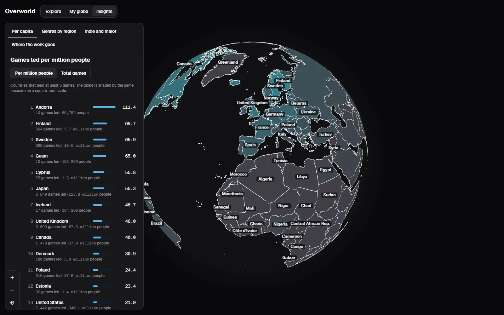
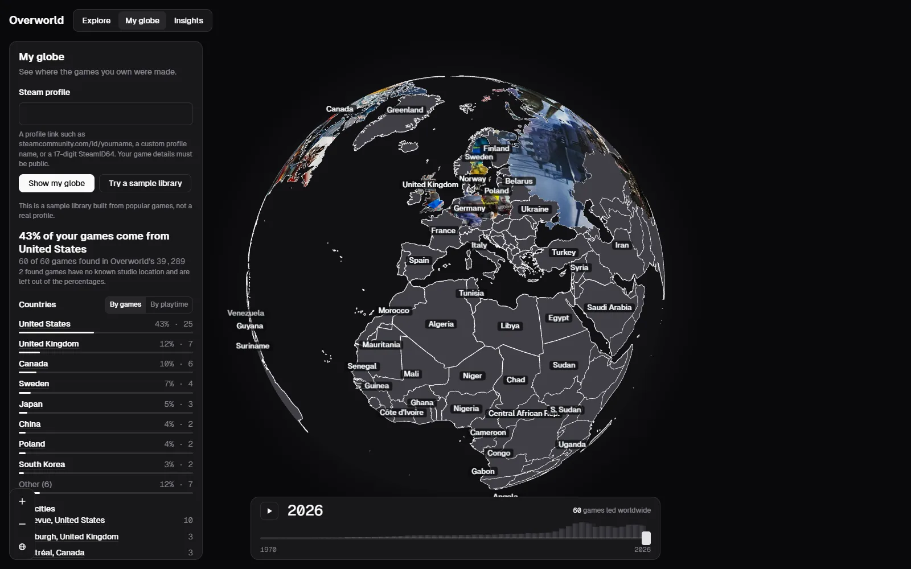
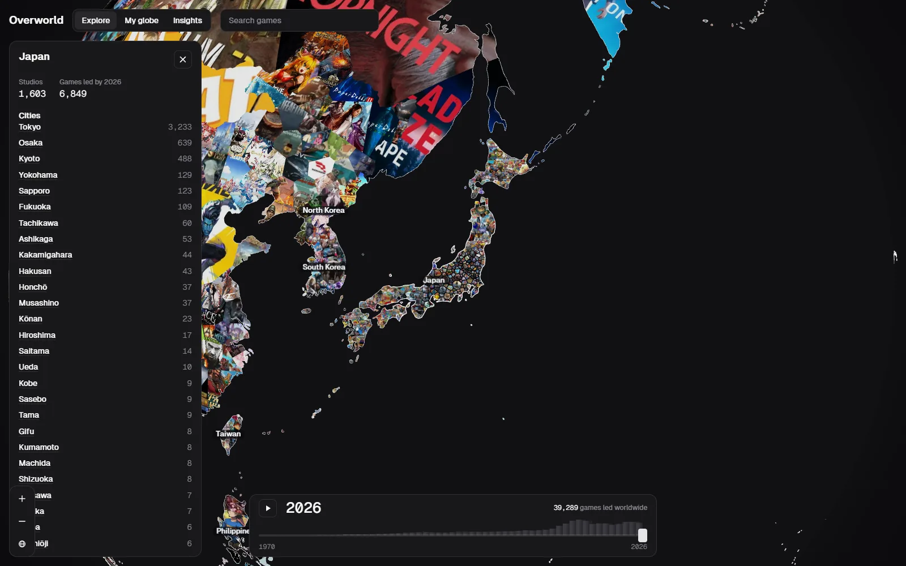
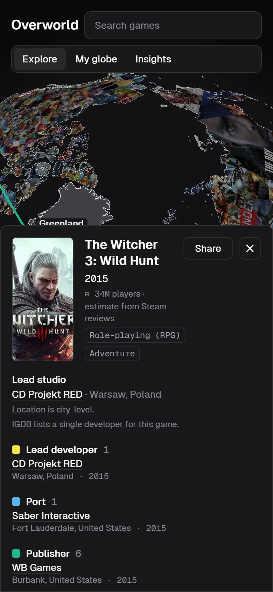
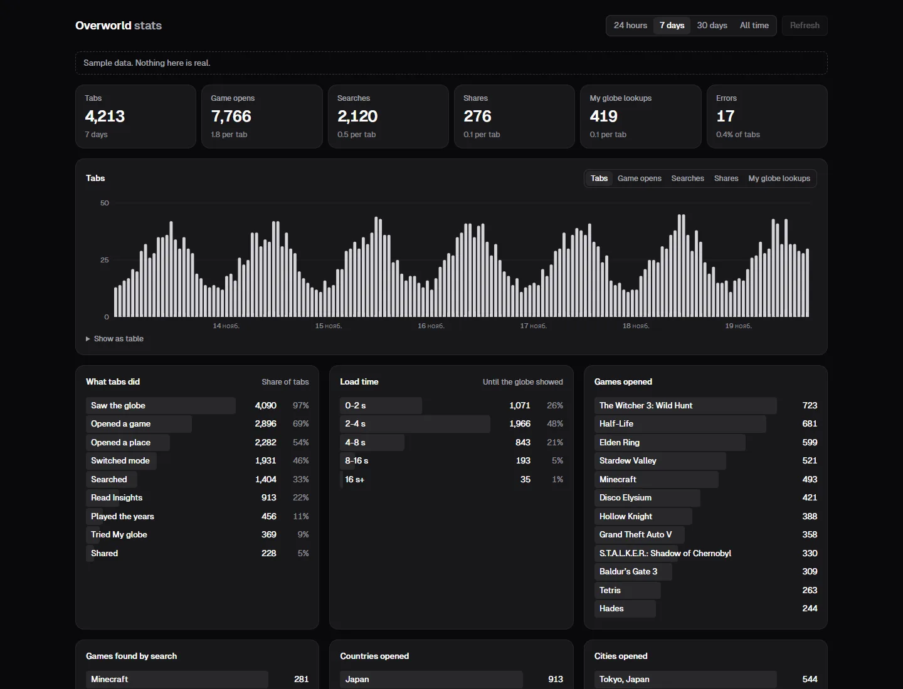

# Overworld

**A 3D globe of where video games are made.**

Every country is filled with the covers of the games made there, about 30,000 of them. Open a game and arcs fly from its lead studio to every company that worked on it, colored by role: co-development, ports, publishing, localization, QA, art and audio. Drag the year slider and watch the industry grow from 1970 to today.


## What it does

- **Explore.** Each country is a mosaic of its games, sized by how many people played them. Zoom in and the cells split until every game has its own. Click a country, a city or a studio for its list, or search any title.
- **A card per game.** The lead studio and where it is, every other company with its role and city, the estimated number of players, and a link to each source record.
- **My globe.** Enter a public Steam profile and see where your library was made: "43% of your games come from the United States". A sample library works without one.
- **Insights.** Games per million people by country, genres by region, indie and major publishers over time, and where outside work flows between countries.
- **Sharing.** Every view has a link. The 10,000 most played games get their own link-preview pages, and any card can be saved or shared as an image.



<p align="center">
  
  
</p>

## How it works

### One pipeline, many sources

```
SteamSpy, Steam ──► who played what (owner bands, review counts)
RAWG            ──► console and older games
IGDB            ──► games, companies, roles, covers
Wikidata        ──► studio headquarters and coordinates, populations
MobyGames       ──► extra credits for the most played games
pipeline/data/  ──► hand-kept corrections, each with an evidence link
                          │
                 merge ──► validate ──► static JSON in web/public/data/
```

The game set is every IGDB main game, remake or remaster with at least 5,000 estimated players: 39,289 games and 22,349 companies. Players come from the strongest signal a game has: Steam reviews, IGDB "Played" marks, RAWG adds or IGDB ratings, each calibrated against Steam. Countries with few studios also get their best known games, plus a hand-checked list for countries IGDB has no studios for, so 162 countries are on the map.

### Every point can be traced

Each game records how its lead studio was chosen, and each studio how its location was found: a hand correction, a Wikidata headquarters statement, its parent's city, or only a country. The game card shows this, so a weak guess looks like one. Every record keeps the name and id of the source it came from.

### A mosaic of 30,000 covers

Each country is cut into cells with a power diagram (a weighted Voronoi treemap) in an equal-area projection: first between its metro areas, then between their games, with each cell's area following popularity. The whole globe starts at 3,000 cells; zooming in adds cells for the countries in view until every game has one. Fitting runs in a worker, every year is fitted once at build time, and small covers ship as sprite sheets so the mosaic appears whole instead of tile by tile.

<p align="center">
  
  
</p>

### Static files and one small Worker

The site is plain static files. A Cloudflare Worker does two things only: it keeps the Steam key off the browser for My globe, and it relays anonymous usage events. Without it, everything but those two still works.

Known limits:

- A studio sits where it is based now, not where it was when each game was made.
- IGDB has no flags for localization, QA, art or audio work, so those arcs are sparse.
- About 8,800 games are not drawn because no source knows their lead studio's country.

More in [docs/ARCHITECTURE.md](docs/ARCHITECTURE.md).

## Privacy

The public site counts anonymous usage: games opened, searches, shares, load time and errors. No cookies, no IP addresses, no search text, no Steam profiles. Raw events are deleted after 48 hours, leaving hourly counts. Open any page with `?noanalytics=1` and nothing is sent; Do Not Track and Global Privacy Control are respected.

The counts are shown on `/admin.html` to the addresses on its admin list. The full list of what is recorded is in [docs/PRIVACY.md](docs/PRIVACY.md).

<p align="center">
  
</p>

## Run it locally

Node 22 or newer.

```bash
git clone https://github.com/Maybaah/overworld.git
cd overworld
npm install
npm run fixture
npm run dev
```

That is the app at `http://localhost:5173` on 10,000 obviously fake games, with no API keys. `/admin.html?mock=1` shows the admin page with sample numbers.

### With real data

Copy `.env.example` to `.env`, fill in the keys, then build the data:

```bash
npm run pipeline
npm run sprites
npm run layouts
npm run dev:real
```

The pipeline caches every response in `pipeline/.cache/` and skips stages that already ran. `-- --refresh` fetches again; `-- --only=merge,validate` reruns single stages.

| Key | Needed for | Where to get it |
| --- | --- | --- |
| `TWITCH_CLIENT_ID`, `TWITCH_CLIENT_SECRET` | IGDB, required | <https://dev.twitch.tv/console/apps> |
| `RAWG_API_KEY` | console and older games | <https://rawg.io/apidocs> |
| `MOBYGAMES_API_KEY` | extra credits, optional | <https://www.mobygames.com/info/api/> |
| `STEAM_API_KEY` | My globe | <https://steamcommunity.com/dev/apikey> |
| `WIKIDATA_USER_AGENT_CONTACT` | a contact for Wikidata's API policy | a URL or email of your choice |

Keys live only in `.env`, which is git-ignored.

### Commands

| Command | What it does |
| --- | --- |
| `npm run dev` | the app on sample data |
| `npm run dev:real` | the app on real data from `web/public/data/` |
| `npm test` | all tests; `test:pipeline` and `test:web` run one side |
| `npm run typecheck` | TypeScript, pipeline and app |
| `npm run build` | production build into `web/dist/`, with `/admin.html` and share pages |
| `npm run pipeline` | fetch, merge, write and validate the data |
| `npm run sprites`, `npm run layouts` | cover sprite sheets and yearly mosaic layouts, after the pipeline |
| `npm run supabase -- migrate` | apply the usage stats schema to your Supabase project |

<details>
<summary><b>Project layout</b></summary>

```
shared/model.ts   the data contract between the pipeline and the app
pipeline/         fetch stages, merge, validation, hand-kept corrections
web/src/          data layer, globe, panels, modes, sharing, telemetry, admin page
web/server/       the Cloudflare Worker: Steam relay and events relay
web/scripts/      build steps: sprites, mosaic layouts, share pages
supabase/         usage stats schema and its tests
docs/             architecture, self-hosting, privacy, API research
```

</details>

## Self-hosting

A fork runs as a static site with no backend. My globe needs the Worker with a Steam key; usage stats need a free Supabase project. Nothing is recorded until you set one up. Step by step: [docs/SELF-HOSTING.md](docs/SELF-HOSTING.md).

## Data and credits

| Source | Used for |
| --- | --- |
| [IGDB](https://www.igdb.com) | games, companies, roles, covers and screenshots, under the IGDB API terms |
| [Wikidata](https://www.wikidata.org) | headquarters, coordinates and populations (CC0) |
| [MobyGames](https://www.mobygames.com) | extra developer and publisher credits |
| [RAWG](https://rawg.io) | player signals for console and older games; each game card links its RAWG page |
| [SteamSpy](https://steamspy.com) and the Steam Web API | player estimates, and the libraries in My globe |
| [GeoNames](https://www.geonames.org) | city coordinates for corrections (CC BY 4.0), through `all-the-cities` |
| [Natural Earth](https://www.naturalearthdata.com) | country shapes, through `world-atlas` |
| Geist and Geist Mono | fonts by Vercel (SIL OFL 1.1) |

Overworld is not affiliated with or endorsed by IGDB, Twitch, Wikidata, MobyGames, RAWG, Valve or any game company. Game titles and artwork belong to their owners.

## Contributing and license

Corrections to studio locations and lead studios are the most useful contribution and need no code: [CONTRIBUTING.md](CONTRIBUTING.md) shows the format. Report security issues privately, as [SECURITY.md](SECURITY.md) describes.

Code under the [MIT License](LICENSE), © 2026 Artem Kovtoniuk and Overworld contributors. Libraries, fonts, map data and game data keep their own terms: [THIRD_PARTY_NOTICES.md](THIRD_PARTY_NOTICES.md).
