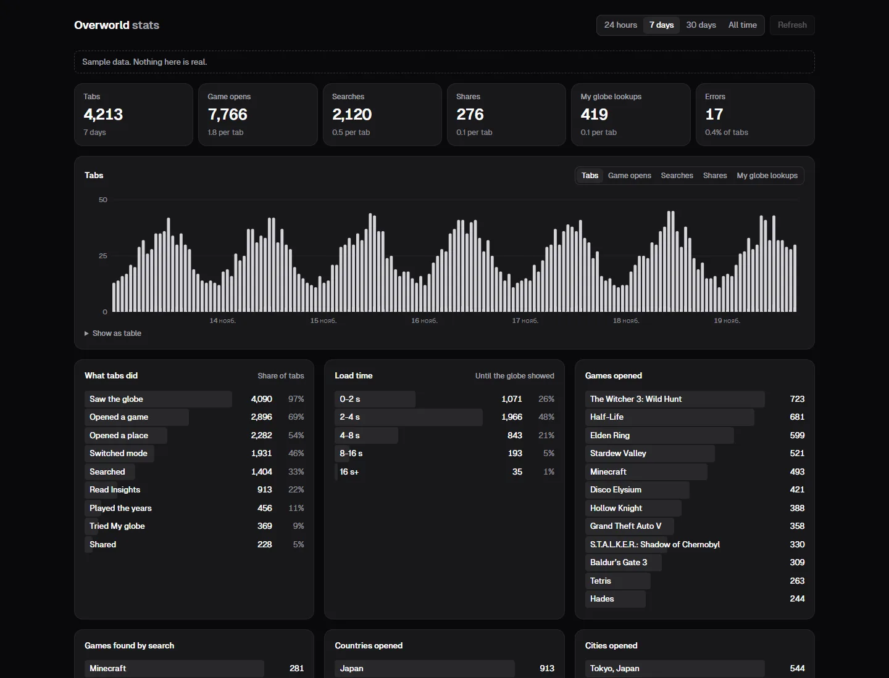

# Running Overworld in production

This takes a fork from `git clone` to a live site on your own domain. The site is static files plus one small Cloudflare Worker, deployed together with one command. Usage stats are optional and need a free Supabase project.

| Step | Time | Needed for |
| --- | --- | --- |
| [1. Accounts and keys](#1-accounts-and-keys) | 20 min | everything |
| [2. Build the data](#2-build-the-data) | a few hours the first time, mostly waiting | real games on the globe |
| [3. Configure the build](#3-configure-the-build) | 5 min | links, previews, stats |
| [4. Deploy to Cloudflare](#4-deploy-to-cloudflare) | 10 min | the live site, My globe |
| [5. Usage stats](#5-usage-stats-optional) | 15 min | `/admin.html` (optional) |
| [6. Check the live site](#6-check-the-live-site) | 5 min | |
| [7. Updating](#7-updating) | | later releases |

Only want to look around? `npm install && npm run fixture && npm run dev` runs everything locally on sample data, with no accounts.

## 1. Accounts and keys

Put the keys in `.env` at the repository root (copy `.env.example`). It is git-ignored.

| Account | Cost | Gives you | Goes in |
| --- | --- | --- | --- |
| [Twitch developer](https://dev.twitch.tv/console/apps): register an application, any OAuth redirect such as `http://localhost` | free | IGDB access, required | `.env`: `TWITCH_CLIENT_ID`, `TWITCH_CLIENT_SECRET` |
| [RAWG](https://rawg.io/apidocs) | free | console and older games | `.env`: `RAWG_API_KEY` |
| [MobyGames](https://www.mobygames.com/info/api/) | free Hobbyist key | extra credits; optional | `.env`: `MOBYGAMES_API_KEY` |
| [Steam Web API](https://steamcommunity.com/dev/apikey): asks for your site's domain | free | My globe | a Worker secret, step 4 |
| [Cloudflare](https://dash.cloudflare.com/sign-up) | free plan is enough | hosting and the Worker | step 4 |
| [Supabase](https://supabase.com) | free plan is enough | usage stats; optional | step 5 |

Also set `WIKIDATA_USER_AGENT_CONTACT` in `.env` to a URL or email: Wikidata asks every client for a contact.

## 2. Build the data

```bash
npm install
npm run pipeline
npm run sprites
npm run layouts
```

- `npm run pipeline` fetches from every source, merges and validates. The first run takes hours, mostly MobyGames, which allows 720 requests an hour (about 14 hours for its 10,000 games). Leave `MOBYGAMES_API_KEY` empty to skip it; the globe works without it.
- Every response is cached in `pipeline/.cache/`, so an interrupted run picks up where it stopped. Run the same command again.
- `npm run sprites` packs small covers into sheets; `npm run layouts` fits the mosaic for every year. Both read `web/public/data/` and take a few minutes.
- `reports/validation.md` lists what the data is missing. Look at it once.

Check it locally before going further:

```bash
npm run dev:real
```

## 3. Configure the build

Create `web/.env.production.local` (git-ignored). Vite and the share-page step both read it.

```ini
# The address the site will live at, no trailing slash. Link previews need it.
SITE_URL=https://overworld.example

# Usage events. Leave all four out to send nothing.
VITE_EVENTS_URL=/api/e
VITE_TELEMETRY_HOSTS=overworld.example,www.overworld.example
VITE_SUPABASE_URL=https://<project-ref>.supabase.co
VITE_SUPABASE_PUBLISHABLE_KEY=<publishable key>
```

| Variable | When to set it |
| --- | --- |
| `SITE_URL` | always; without it link previews on social sites have no image or title |
| `VITE_BASE` | only if the site is served from a sub-path, such as `/overworld/` |
| `VITE_EVENTS_URL`, `VITE_TELEMETRY_HOSTS` | with usage stats (step 5). Other hosts, such as preview deploys, then send nothing |
| `VITE_SUPABASE_URL`, `VITE_SUPABASE_PUBLISHABLE_KEY` | with usage stats, for the admin page's sign-in. Use the publishable (anon) key, never a secret or service-role key: every `VITE_` value is visible to anyone |
| `VITE_STEAM_PROXY_URL` | only if the Worker runs on another origin than the site |

## 4. Deploy to Cloudflare

`wrangler.toml` at the repository root deploys `web/dist/` as static assets and `web/server/worker.ts` for `/api/*`, as one Worker.

1. Sign in once:

   ```bash
   npx wrangler login
   ```

2. Change `name` in `wrangler.toml` if you want another Worker name.
3. Deploy:

   ```bash
   npm run deploy
   ```

   This builds the site (with the share pages) and uploads it. The output ends with a `*.workers.dev` address: the site is live there.
4. Add the Steam key, so My globe works:

   ```bash
   npx wrangler secret put STEAM_API_KEY
   ```

5. Use your own domain: Cloudflare dashboard → **Workers & Pages** → the Worker → **Settings → Domains & Routes → Add → Custom domain**. The domain must be on Cloudflare DNS. Then set `SITE_URL` and `VITE_TELEMETRY_HOSTS` to it and deploy again.

`web/public/_headers` sets the security headers, including a Content Security Policy that allows images from `images.igdb.com` and the admin page's calls to `*.supabase.co`. If you add another outside host, add it there too, or the browser will block it.

Free plan limits: 20,000 files per deploy (a full build has about 13,600: 10,000 game share pages and 3,400 country and studio pages), 25 MiB per file, 100,000 Worker requests a day. Static files do not count toward the request limit; only `/api/*` calls do.

## 5. Usage stats (optional)

1. Create a project at <https://supabase.com>. Note its **project ref** (in the URL) and, under **Project Settings → API keys**, the **publishable** key (for the admin page) and a **secret** key (for the Worker only).
2. Apply the schema. Either paste `supabase/migrations/0001_telemetry.sql` into the SQL editor and run it, or use a [personal access token](https://supabase.com/dashboard/account/tokens):

   ```bash
   SUPABASE_PROJECT_REF=<ref> SUPABASE_ACCESS_TOKEN=<token> npm run supabase -- migrate
   ```

3. Put yourself on the admin list. Addresses never go into the repository:

   ```bash
   SUPABASE_PROJECT_REF=<ref> SUPABASE_ACCESS_TOKEN=<token> npm run supabase -- add-admin you@example.com
   ```

   On Windows PowerShell, set the two values first with `$env:SUPABASE_PROJECT_REF="<ref>"` and `$env:SUPABASE_ACCESS_TOKEN="<token>"`, or put them in `.env`.
4. Create the same address as a user: **Authentication → Users → Add user → Send invitation**. The admin page never creates accounts, so a stranger who finds it cannot sign up.
5. **Authentication → URL Configuration**: set the site URL to your domain and add `https://<your domain>/admin.html` and `https://<your domain>/admin` to the redirect URLs.
6. Give the Worker the relay settings:

   ```bash
   npx wrangler secret put SUPABASE_URL
   npx wrangler secret put SUPABASE_SECRET_KEY
   npx wrangler secret put TELEMETRY_HOSTS
   ```

   `SUPABASE_SECRET_KEY` is the secret key from step 1. Only the Worker may write events: the publishable key in the browser cannot call `log_events`, so nobody can skip the relay. `TELEMETRY_HOSTS` is the same comma-separated list as `VITE_TELEMETRY_HOSTS`; the relay drops events from any other origin.
7. Add the four `VITE_` values from step 3 and run `npm run deploy` again.

How the data is kept, what is recorded and what never is: [PRIVACY.md](PRIVACY.md). In short, `log_events` checks every field against an allow-list and rate-limits every tab and the whole site; tabs and events are rolled into hourly counts and deleted after 48 hours; no cron job is needed.

<p align="center">
  
</p>

A free Supabase project is paused after a week with no requests. Live traffic keeps it awake; if the site is quiet, unpause it from the dashboard.

## 6. Check the live site

| Open | Expect |
| --- | --- |
| `/` | the globe fills with covers within a few seconds |
| `/?game=1942` | The Witcher 3 opens with arcs to its other companies |
| `/g/1942/` | redirects to the game; its source has `og:` tags with your domain |
| `/countries/poland/`, `/studios/cd-projekt-red/` | plain pages with the country's or studio's games, linked from `/sitemap.xml` |
| My globe → **Try a sample library** | the globe filters to 60 games |
| My globe with a public Steam profile | a breakdown by country; "not configured" means `STEAM_API_KEY` is missing |
| `/admin.html?mock=1` | the stats page with sample numbers |
| `/admin.html` | the sign-in form; "No backend configured" means the `VITE_SUPABASE_` values were missing at build time |

To see events arrive: open the site in a normal window (not with `?noanalytics=1`, and with Do Not Track off), click around, wait a few seconds, then sign in to `/admin.html` and pick **24 hours**. If nothing shows, `npx wrangler tail` shows the Worker's requests to `/api/e`.

## 7. Updating

- **Code:** `git pull`, then `npm run deploy`.
- **Data:** `npm run pipeline -- --refresh`, `npm run sprites`, `npm run layouts`, then `npm run deploy`. Without `--refresh` the pipeline reuses its cache and only reruns what changed.
- **Schema:** `npm run supabase -- migrate`. Migrations are idempotent.
- `.github/workflows/refresh-data.yml` is a weekly rebuild for GitHub Pages and stays off until the repository variable `REFRESH_ENABLED` is `true`. It does not deploy to Cloudflare, and a full refresh does not fit in its one-hour limit without a cache, so refresh by hand as above.

## If something is wrong

| Symptom | Cause |
| --- | --- |
| Grey countries, no covers | `npm run sprites` or `npm run layouts` was not run after the pipeline, or the deploy was built before them |
| An error instead of the globe | `web/public/data/` was empty when the site was built. Run step 2, then deploy again |
| Link previews show no image | `SITE_URL` was not set at build time |
| My globe says "not configured" | `npx wrangler secret put STEAM_API_KEY` |
| Admin sign-in link says expired | some mail scanners open links first; send a new one, or add a second admin address |
| Admin says "Not an admin" | the signed-in address is not in `overworld_private.admins`; run `add-admin` with exactly that address |
